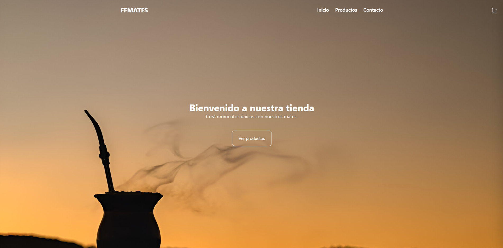

# Facundo Bisio | Senior Frontend Portfolio

<div align="center">



[](https://www.linkedin.com/in/facundo-bisio-25a104247/)
[](mailto:facubisio433@gmail.com)
[](https://maps.google.com/?q=Córdoba,Argentina)
[](https://www.linkedin.com/in/facundo-bisio-25a104247/)

</div>

---

## 👋 About Me

Hi, I'm **Facundo Bisio**, a **Systems Engineering Student** at Universidad Siglo 21 and a **Fullstack Creator** based in Córdoba, Argentina.

I specialize in building high-performance web applications with the **MERN stack**, focusing on scalable architecture, intuitive UX, and clean code. My experience includes:

- 🏥 Developing patient management systems for **DownIsUp Córdoba**.
- 🛒 Building full-featured e-commerce platforms.
- 👨‍💻 Optimizing web performance as an Intern at **Kunan S.A.** in Agile/Scrum environments.

I combine academic foundations with a pragmatic, product-focused approach to shipping real-world software.

---

## 🛠️ Technical Arsenal

### 🎨 Frontend


### 🔙 Backend


### ⚙️ Tools & DevOps


### 🗣️ Languages

- **Spanish**: Native
- **English**: B2/C1 (FCE)

---

## 🚀 Portfolio Engineering

This specific portfolio project is engineered to demonstrate advanced frontend capabilities:

### 🏗 Architecture

- **Global State Management**: Powered by a custom `UIContext` (Context API) to manage overlays like Toasts and Lightboxes without prop drilling.
- **Atomic Design Structure**: Organized code into `layout`, `sections`, and reusable `ui` components for scalability.
- **Single Source of Truth**: Project data is consolidated in `src/data/projects.js`, decoupling content from logic.

### ⚡ Performance

- **Code Splitting**: Heavy sections (`Projects`, `Skills`, etc.) are lazy-loaded using `React.lazy` and `Suspense`, improving Initial Load Time.
- **Web Vitals Optimized**: Semantic HTML structure and optimized asset loading.

### 🎨 UX & Animations

- **Micro-Interactions**: Hover effects, scroll-linked reveal animations, and "Spotlight" mouse tracking.
- **Framer Motion Variants**: Reusable animation utilities (`staggerContainer`, `fadeInUp`) for consistent motion design.
- **Optimistic UI**: Instant feedback on interactions.

---

## 📂 Project Structure

```bash
src/
├── components/
│   ├── layout/       # Global layout wrappers (Navbar, Footer)
│   ├── sections/     # Page sections (Hero, Projects, Experience) (Lazy Loaded)
│   └── ui/           # Reusable atoms (Toast, Lightbox, Badge)
├── context/
│   └── UIContext.jsx # Global UI State
├── data/             # Static content (projects.js)
├── utils/            # Helpers & Animation variants
└── App.jsx           # Entry point with Routing/Providers
```

---

## 🚦 Getting Started

1. **Clone the repository**

   ```bash
   git clone https://github.com/FacundoBisio/facundo-portfolio.git
   ```

2. **Install dependencies**

   ```bash
   npm install
   ```

3. **Run development server**
   ```bash
   npm run dev
   ```

---

## 📬 Let's Connect

I'm always open to discussing new projects, creative ideas, or opportunities to be part of your visions.

- **Email**: [facubisio433@gmail.com](mailto:facubisio433@gmail.com)
- **LinkedIn**: [Facundo Bisio Griffa](https://www.linkedin.com/in/facundo-bisio-25a104247/)
- **Phone**: +54 9 351 366 2570

<div align="center">
  <p><i>Rights by Facundo Bisio</i></p>
</div>
